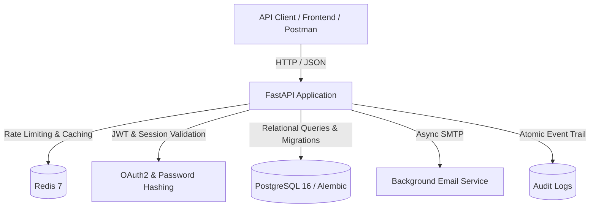

# TaskFlow API

A multi-tenant project and task management REST API built with FastAPI, designed with production-ready backend patterns including workspace-governed role-based access control (RBAC), multi-tenant isolation, Redis caching, rate limiting, token-version session revocation, and atomic audit logging.

---

## Architecture Overview



### Hierarchy & Authorization Model

```
Workspace (Owner / Admin / Member / Viewer)
   └── Project (Public or Private)
         └── Task (Assigned to Workspace Member, Status, Priority)
               └── Comment (Threaded discussion by Task Collaborators)
```

1. **Workspace-Governed RBAC**:
   - `owner`: Full workspace control, can delete workspace and transfer ownership.
   - `admin`: Can invite/remove members, create and manage projects, delete comments.
   - `member`: Can create projects, create and update tasks, post comments.
   - `viewer`: Read-only access across all public workspace resources.
2. **Project Privacy & Dual Authorization**:
   - Projects can be public (accessible by all workspace members) or private (restricted to project members).
   - **Dual Authorization**: Both Workspace Admins/Owners AND Project Admins/Owners can invite members to private projects and update project settings.
   - Accepting a project invitation automatically enrolls the recipient as a member in the parent workspace.
3. **Session Revocation**:
   - Instant token invalidation via `token_version` on user accounts. Logging out bumps the version, invalidating all issued JWTs without requiring database session lookup tables or Redis token blacklists.
4. **Data Integrity & Audit Trails**:
   - Soft-deactivation for user deletion (`user.active = False`) and soft-deletes for workspaces, projects, and tasks to preserve historical audit records.
   - Audit entries are staged within the business transaction and committed atomically in a single unit of work.

---

## Tech Stack

- **Framework**: [FastAPI](https://fastapi.tiangolo.com/) (Python 3.12+)
- **Database**: PostgreSQL 16 with [SQLAlchemy ORM](https://www.sqlalchemy.org/)
- **Migrations**: [Alembic](https://alembic.sqlalchemy.org/)
- **Cache & Rate Limiting**: Redis 7
- **Security**: JWT (python-jose), Argon2 / Passlib password hashing, cryptographically secure OTP generation (`secrets`)
- **Containerization**: Docker & Docker Compose (Development and Production configurations)
- **CI/CD**: GitHub Actions

---

## Features & Endpoints

- **Authentication & User Management**:
  - Secure registration with 6-digit email OTP verification.
  - Rate-limited login and OTP verification endpoints.
  - Token-version based `/logout` to revoke sessions immediately.
  - Safe user profile updates and soft-deactivation.
- **Workspaces & Projects**:
  - Multi-tenant workspace isolation.
  - Bounded pagination (`limit` and `offset`) on workspace and project lists.
  - Redis-cached project listings with automatic pattern-based cache invalidation.
- **Tasks & Discussions**:
  - Bounded task pagination with deterministic ordering.
  - Query filtering by `status` (`pending`, `in_progress`, `completed`) and `priority` (`low`, `medium`, `high`, `urgent`).
  - Assignee membership verification (ensures assignees belong to the workspace and private project).
  - Task comments with bounded pagination and permission checks.
- **Health & Readiness**:
  - `/health`: Liveness probe checking application server status.
  - `/ready`: Readiness probe verifying downstream PostgreSQL connectivity.

---

## Quick Start

### Option 1: Docker Compose (Development)

1. Clone the repository:
   ```bash
   git clone https://github.com/your-username/taskflow-api.git
   cd taskflow-api
   ```

2. Copy the template environment configuration:
   ```bash
   cp .env.example .env
   ```

3. Spin up the application, PostgreSQL, and Redis containers:
   ```bash
   docker compose up --build
   ```

4. Access the interactive API documentation:
   - **Swagger UI**: [http://localhost:8000/docs](http://localhost:8000/docs)
   - **ReDoc**: [http://localhost:8000/redoc](http://localhost:8000/redoc)

### Option 2: Docker Compose (Production)

The production configuration keeps PostgreSQL and Redis internal, uses 4 Uvicorn workers, and performs container readiness checks against `/ready`:
```bash
docker compose -f docker-compose.prod.yml up --build -d
```

### Option 3: Local Development

1. Create and activate a virtual environment:
   ```bash
   python3 -m venv .venv
   source .venv/bin/activate
   ```

2. Install dependencies:
   ```bash
   pip install -r requirements.txt
   ```

3. Configure your `.env` file (refer to `.env.example`).

4. Run migrations:
   ```bash
   alembic upgrade head
   ```

5. Start the development server:
   ```bash
   uvicorn app.main:app --reload
   ```

---

## Running Tests

The test suite runs against an in-memory SQLite database and test Redis instance.

```bash
# Run all tests
pytest -v

# Run RBAC and authorization tests specifically
pytest -v tests/test_rbac.py

# Run authentication and session revocation tests
pytest -v tests/test_auth.py
```

---

## API Testing with Postman

A pre-configured Postman collection and environment files are available under `postman/`:
- **Collection**: `postman/collections/TaskFlow API/` (includes automated JWT token extraction on login)
- **Environments**: `postman/environments/DEV- PM.environment.yaml` and `PROD- PM.environment.yaml`

---

## Design Decisions & Trade-offs

- **Soft Deactivation vs. Hard Delete**: Deleting a user soft-deactivates the account (`active = False`, session invalidated) to avoid cascading deletion of owned workspaces and historical audit logs.
- **Fail-Open Rate Limiting**: If Redis becomes temporarily unreachable, rate limiting logs a warning and allows requests through to prevent taking down the entire API for transient cache failures.
- **Token Versioning vs. Blacklists**: Storing an integer `token_version` on the user record allows immediate global logout without the storage overhead or lookups of distributed token blacklists.
